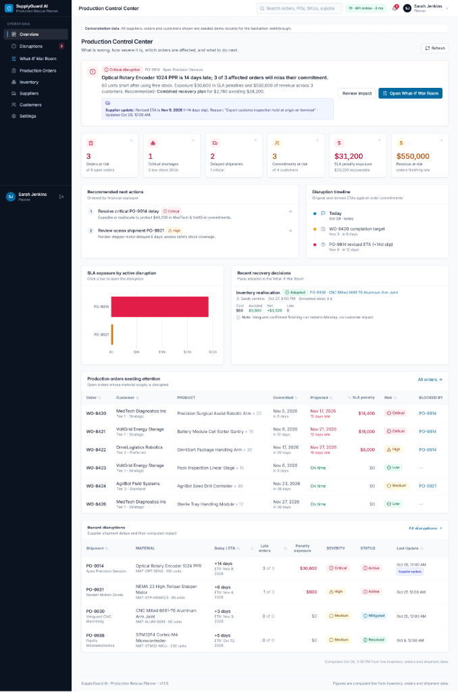
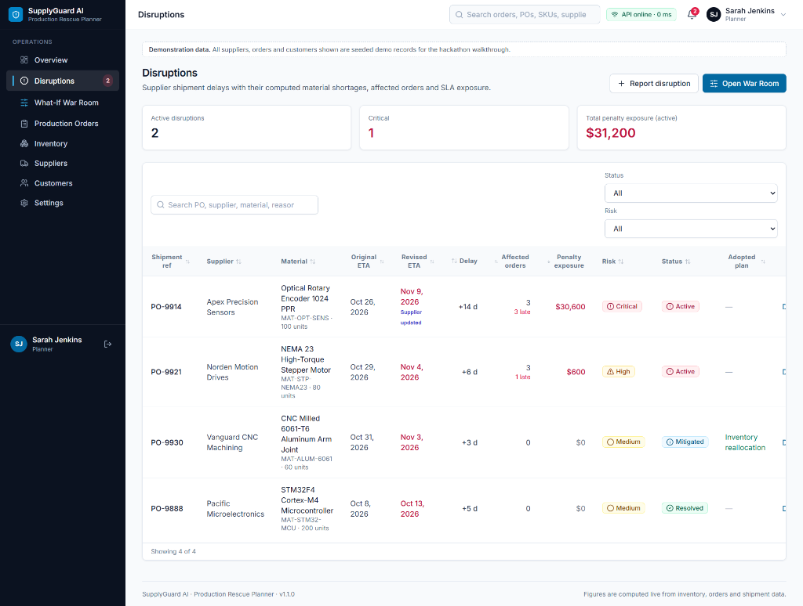
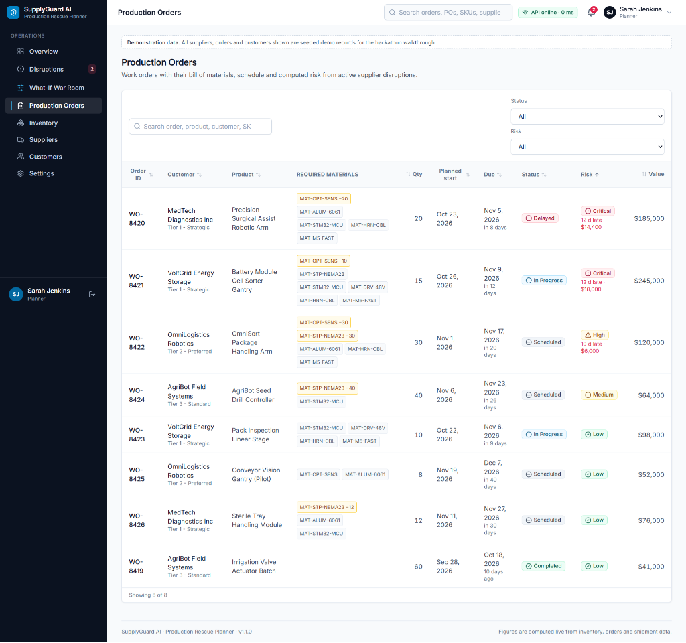
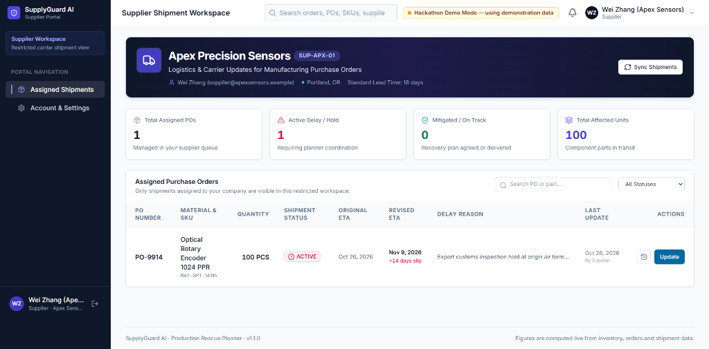

# SupplyGuard AI — Production Rescue Planner

[](https://supplyguardai.netlify.app/)
[](https://github.com/siddhantdandavate/supplyguard-ai)
[](https://fastapi.tiangolo.com/)
[](https://reactjs.org/)

> **When a supplier shipment slips, SupplyGuard AI calculates what is short, traces which production orders and customer commitments it breaks, evaluates recovery trade-offs, and recommends the best course of action — in seconds instead of a day of spreadsheet fire drills.**

---

## 1. Hackathon Track: Entrepreneurship & Local Business

Developed for the **PromptWars × Kick To Tech Hackathon**, SupplyGuard AI is entered under the **Entrepreneurship & Local Business** track.

```
Official Hackathon Tracks:
├── Education & Student Life
├── Agriculture & Rural Solutions
├── Cybersecurity & Digital Safety
├── Environment & Sustainability
├── Healthcare & Wellness
└── [★ SELECTED] Entrepreneurship & Local Business
```

### Track Relevance & Context
While hackathon track prompts often suggest entry-level prototypes like simple shop catalogues, manual inventory counters, or basic customer FAQ bots, real-world business survival for small-to-midsize manufacturers and local industrial enterprises hinges on **operational continuity and supply reliability**:

* **Thin Working Capital:** Small manufacturers do not have the balance sheets to hold massive safety buffers. A single delayed component can stall assembly lines and tie up capital in half-finished assemblies.
* **Contractual SLA Penalties:** B2B contracts with strategic enterprise buyers enforce heavy liquidated damages (often $500 to $1,500+ per late day). A one-week transit delay can wipe out a small business's entire quarterly operating margin.
* **Operational Blind Spots:** Spreadsheets fail to answer the critical operational question: *"If this $36 sensor is 14 days late, which customer work order do we sacrifice, what will alternate freight cost, and does expediting actually save the delivery date?"*

**SupplyGuard AI** elevates local business operations by providing enterprise-grade **Supply Chain Disruption & Production Rescue Planning** — empowering planners and business owners to make defensible, quantified trade-off decisions under pressure.

---

## 2. Project Links

* **Live Interactive Demo:** [https://supplyguardai.netlify.app/](https://supplyguardai.netlify.app/)
* **GitHub Repository:** [https://github.com/siddhantdandavate/supplyguard-ai](https://github.com/siddhantdandavate/supplyguard-ai)
* **API Documentation (Local):** `http://127.0.0.1:8000/docs`

---

## 3. The Problem

Small and medium-sized manufacturers build precision products against contractual delivery deadlines. When an inbound shipment slips:

1. **The Real Shortage Is Unknown:** Stock on hand, stock already allocated to work orders, and incoming supply live in separate silos. Planners spend hours reconciling spreadsheets by hand.
2. **Impact Tracing Is Broken:** Planners cannot immediately determine which customer deliveries will be missed, which work orders can absorb the slip, and what financial SLA penalties will be incurred.
3. **Decisions Are Made on Guesswork:** Expedite freight? Source from an unvetted alternate supplier at a 25% premium? Reallocate inventory from another order? Each choice incurs added cost and varying delivery outcomes with no side-by-side trade-off visibility.
4. **Decisions Disappear into Email Chains:** Post-incident rationale is rarely documented, leading to repeated mistakes and zero operational audit trails.

---

## 4. Our Solution

SupplyGuard AI turns inbound supply delays from stressful fire drills into **deterministic, computable decisions**:

1. **Restricted Supplier Portal:** Inbound logistics carriers and suppliers can directly submit revised ETAs, shipment delay reasons, and affected batch sizes into an isolated supplier workspace.
2. **Live Impact Recalculation:** The moment an ETA slips, SupplyGuard instantly recalculates material shortages across open Bills of Materials (BOMs), customer order commitments, and contractual SLA penalties.
3. **Production Control Center:** An executive operational cockpit providing headline disruption alerts, live exposure KPIs, prioritized action queues, and chronological disruption timelines.
4. **What-If War Room:** An interactive simulation environment comparing 5 recovery strategies side-by-side, complete with cost vs. penalty charts, delivery schedules, and plain-language guided executive summaries.

---

## 5. Visual Tour & Screenshots

### Production Control Center
The operational mission control for manufacturing planners. Displays critical headline disruptions, supplier update notices, real-time exposure KPIs, and work orders needing urgent attention.


*Figure 1: Production Control Center — Live KPI metrics, supplier delay alerts, SLA exposure breakdown, and order attention queues.*

---

### Active Disruptions & Impact Tracing
Searchable, filterable register of all open supplier shipment delays showing computed material shortages, late work order counts, penalty exposure, and supplier update timestamps.


*Figure 2: Active Disruptions Register — Real-time tracking of delayed POs, recalculated ETA slips, and supplier origin hold reasons.*

---

### Production Orders & Bill of Materials (BOM) Allocation
Tracks open customer orders against required components, stock allocations, committed delivery dates, and computed schedule risk levels.


*Figure 3: Production Orders — Live visibility into affected customer contracts, component allocation deficits, and projected completion slips.*

---

### Restricted Supplier Shipment Workspace
A dedicated, role-isolated portal for tier-1 suppliers and logistics coordinators. Suppliers can update shipment statuses (e.g. Customs Hold), submit revised ETAs, report delay reasons, and review their update audit history without access to internal planner margins or customer contracts.


*Figure 4: Supplier Workspace — Role-restricted portal for carrier ETA updates, delay reasons, and audit logging.*

---

## 6. The What-If War Room: Plain-Language Decision Making

The signature feature of SupplyGuard AI is the **What-If War Room**. Built specifically so non-technical manufacturing planners and plant managers can make informed decisions in seconds.

### The 5 Guided Decision Pillars
At the top of the War Room, a dynamic **Guided Decision Summary** translates complex BOM math and penalty models into clear operational language:

| Decision Pillar | Operational Question | What It Explains |
|---|---|---|
| **1. Situation** | *What happened?* | Details the specific component delay, total shortage after free stock, affected work orders, and exposed customer delivery dates. |
| **2. Recommended Action** | *What should I do?* | Concrete recovery instructions (e.g., *"Expedite remaining transit by 11 days and release 10 reserved units from low-priority buffer stock"*). |
| **3. Why This Plan?** | *Why is this recommended?* | Transparent financial justification: added recovery cost, days recovered, avoided SLA penalties, and net financial benefit. |
| **4. Remaining Risks** | *What remains at risk?* | Explicitly spells out which work orders will still finish late, residual penalty exposure, and remaining component deficits. |
| **5. Next Step** | *What happens if I adopt this plan?* | One-click **Adopt This Plan** action that transitions the disruption to `Mitigated`, saves the audit log, and updates shop-floor schedules. |

### The 5 Evaluated Strategies

Every disruption is deterministically evaluated across five strategies:

```
Recovery Strategies
├── 1. Baseline (No Intervention)    ──> Accept the slip; absorb maximum SLA penalties and late deliveries.
├── 2. Expedited Shipment           ──> Pay freight premium to recover ~60% of transit delay.
├── 3. Alternate Secondary Supplier ──> Purchase uncovered units from pre-qualified secondary source.
├── 4. Inventory Reallocation       ──> Reallocate reserved stock from orders with buffer to critical orders.
└── 5. Combined Recovery Plan       ──> Expedited freight combined with strategic inventory reallocation.
```

**Selection Rule:** The engine recommends the strategy with the lowest **Total Exposure = Added Recovery Cost + Remaining SLA Penalties**, tie-broken by fewest late orders, then lowest added cost.

---

## 7. Technology Stack

### Frontend
* **Core:** React 18, TypeScript, Vite
* **Styling & UI:** Tailwind CSS, Lucide Icons, Headless UI patterns
* **Data Visualization:** Recharts (SLA cost vs. penalty exposure bar charts, delivery timelines)
* **Routing & Architecture:** React Router v6 with Netlify SPA redirects
* **Demo Engine:** Standalone client-side deterministic simulation engine enabling full browser demoability on Netlify without requiring a live backend.

### Backend
* **Web Framework:** FastAPI (Python 3.11+)
* **Database & ORM:** PostgreSQL / SQLite (via SQLAlchemy 2.0)
* **Data Validation:** Pydantic v2 schemas with strict typing
* **Authentication:** OAuth2 with JWT bearer tokens (HS256) and passlib/bcrypt password hashing
* **Role-Based Access Control (RBAC):** Strict dependency guards distinguishing `Planner`, `Admin`, and `Supplier` roles.

---

## 8. System Architecture

```
┌─────────────────────────────────────────────────────────────────────────────┐
│                       SUPPLYGUARD AI ARCHITECTURE                           │
└─────────────────────────────────────────────────────────────────────────────┘

       [Supplier Role]                         [Planner / Admin Role]
  (Logistics & Carrier Updates)              (Control Center & War Room)
               │                                          │
               ▼                                          ▼
   ┌──────────────────────────────────────────────────────────────┐
   │                   React 18 Single Page App                   │
   │      - Role-Based Routing & Workspace Isolation              │
   │      - Recharts Cost / Penalty Exposure Analytics            │
   │      - Guided Decision Summary & What-If War Room            │
   │      - Standalone Client-Side Demo Engine Fallback           │
   └───────────────┬──────────────────────────────────────────────┘
                   │
                   │ HTTPS / JSON REST API (Bearer JWT)
                   ▼
   ┌──────────────────────────────────────────────────────────────┐
   │                     FastAPI Application                      │
   │  ┌───────────────────────┐        ┌───────────────────────┐  │
   │  │   Auth & RBAC Deps    │        │  Supplier REST Router │  │
   │  └───────────────────────┘        └───────────────────────┘  │
   │  ┌────────────────────────────────────────────────────────┐  │
   │  │               Deterministic Recovery Engine            │  │
   │  │  - Material Shortage & Priority BOM Allocation         │  │
   │  │  - Multi-Strategy Simulation (Expedite, Realloc, etc.) │  │
   │  │  - Trade-off Exposure & Recommendation Optimizer       │  │
   │  └────────────────────────────────────────────────────────┘  │
   └───────────────┬──────────────────────────────────────────────┘
                   │ SQLAlchemy 2.0 ORM
                   ▼
   ┌──────────────────────────────────────────────────────────────┐
   │                 Relational Data Persistence                  │
   │   (PostgreSQL in production / SQLite with auto-migration)   │
   │   - Users & Supplier Links      - BOM & Production Orders    │
   │   - Inventory & Reorder Points  - Shipment Delays & Audit    │
   │   - Customers & SLA Contracts   - Recovery Decisions Log     │
   └──────────────────────────────────────────────────────────────┘
```

---

## 9. Seeded Demonstration Dataset

The project includes realistic demonstration data representing an industrial precision robotics manufacturer:

* **Demo Accounts:**
  * **Planner:** `planner@supplyguard.io` / `password123` (Sarah Jenkins)
  * **Admin:** `admin@supplyguard.io` / `admin123` (Marcus Vance)
  * **Supplier:** `supplier@apexsensors.example` / `password123` (Wei Zhang, Apex Sensors)
* **6 Pre-Configured Suppliers:** Apex Precision Sensors, Helios Sensorik, Vanguard CNC, Pacific Microelectronics, Titan Fasteners, Norden Motion Drives.
* **7 Specialized Materials:** Optical Rotary Encoders (1024 PPR), NEMA 23 Steppers, Milled 6061 Aluminum Arms, STM32F4 MCUs, etc.
* **4 Enterprise Customers:** MedTech Diagnostics ($1,200/day SLA penalty), VoltGrid Energy ($1,500/day SLA penalty), OmniLogistics ($600/day), AgriBot ($250/day).
* **Primary Demo Disruption (PO-9914):** 100 units of Optical Rotary Encoders delayed by +14 days due to air terminal customs inspection, threatening $550,000 in committed revenue across 3 critical work orders.

---

## 10. Installation & Local Development

### Prerequisites
* Python 3.11+
* Node.js 18+ & npm

### Backend Setup
```bash
# 1. Navigate to backend directory
cd backend

# 2. Create and activate Python virtual environment
python -m venv .venv
# Windows PowerShell:
.venv\Scripts\Activate.ps1
# Linux / macOS:
# source .venv/bin/activate

# 3. Install dependencies
pip install -r requirements.txt

# 4. Optional: Configure environment (defaults to SQLite supplyguard.db)
copy .env.example .env

# 5. Start the development server
uvicorn app.main:app --reload --host 127.0.0.1 --port 8000
```
*API Swagger Documentation is available at: `http://127.0.0.1:8000/docs`*

### Frontend Setup
```bash
# 1. Open a new terminal and navigate to frontend directory
cd frontend

# 2. Install dependencies
npm install

# 3. Start the Vite development server
npm run dev
```
*Application will be available at: `http://localhost:5173`*

### Automated Verification & Test Suites
```bash
# Run backend pytest suite (31 tests covering RBAC, supplier portal, engine)
cd backend && .venv\Scripts\python.exe -m pytest backend/tests/ -q

# Run end-to-end 9-step workflow test script
python backend/tests/verify_e2e_workflow.py

# Run frontend TypeScript type-check and Vite production build
cd frontend && npm run build
```

---

## 11. Team & Acknowledgements

* **Author & Developer:** Siddhant Dandavate ([GitHub](https://github.com/siddhantdandavate))
* **Event:** PromptWars × Kick To Tech Hackathon
* **Track:** Entrepreneurship & Local Business
* **Special Thanks:** The mentors and organizers of PromptWars and Kick To Tech for inspiring practical, high-impact AI and software solutions for business resilience.
